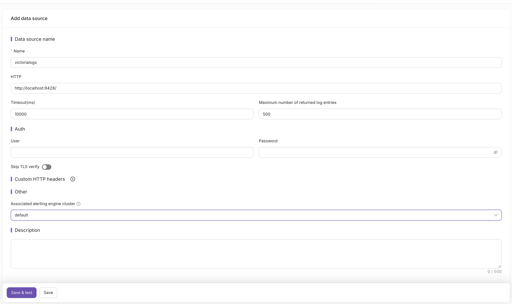
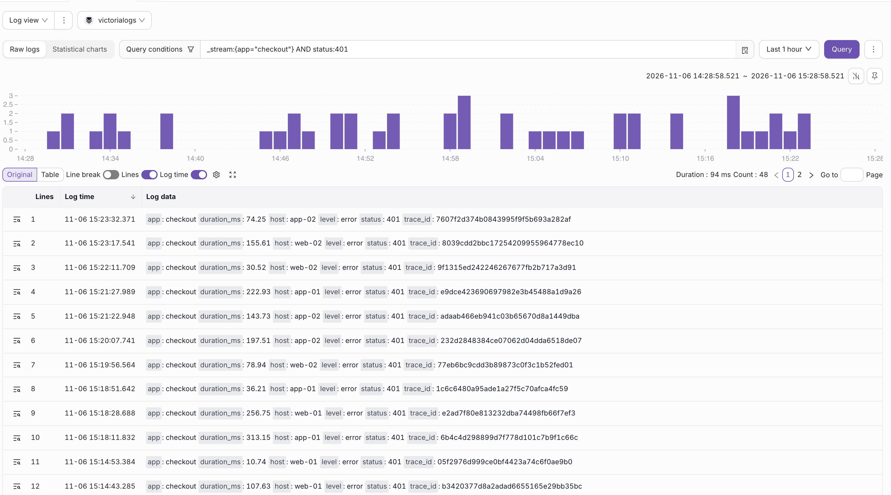

[Nightingale](https://n9e.io/) (n9e) is an open-source monitoring and alerting platform. It connects directly to an existing VictoriaLogs deployment
for searching logs and evaluating log-based alerting rules. It does not ingest or copy logs. Your existing log shipper continues to send data to VictoriaLogs.

Resources:
* [Nightingale on GitHub](https://github.com/ccfos/nightingale)
* [VictoriaLogs datasource docs in Nightingale](https://n9e.io/docs/data/loki-victorialogs#victorialogs-address-and-row-cap)
* [Log alerting rules in Nightingale](https://n9e.io/docs/alerting/log-rules#victorialogs)

## Add a VictoriaLogs datasource

1. Go to `Integrations` → `Data sources` → `Add` and select `VictoriaLogs`.
1. Fill the `HTTP` field with the VictoriaLogs address, for example `http://<victorialogs-addr>:9428/`. Do not add any path suffix.
1. Optionally change `Maximum number of returned log entries` (500 by default).
1. Fill `User` and `Password` if VictoriaLogs is behind basic auth.
   If you use [multitenancy](https://docs.victoriametrics.com/victorialogs/#multitenancy),
   pass `AccountID` and `ProjectID` via `Custom HTTP headers`.
1. Click `Save & test`.

The VictoriaLogs address must be reachable from the Nightingale process, not only from your browser.



## Explore logs

Go to `Explorer` → `Logs`, select the VictoriaLogs datasource and type a [LogsQL](https://docs.victoriametrics.com/victorialogs/logsql/) query:

```logsql
_stream:{app="checkout"} AND status:401
```



Matched logs are shown with a histogram and can be switched between `Original` and `Table` views.
To plot query results as time series, switch to `Statistical charts`, then set `Value field` to the numeric fields to plot
and `Label field` to the fields that separate the series.

## Alerting rules

Go to `Alerts & Notifications` → `Alert rules` → `Add` and select the VictoriaLogs datasource.
The query must end with a [`stats` pipe](https://docs.victoriametrics.com/victorialogs/logsql/#stats-pipe),
since Nightingale executes it as a [stats query](https://docs.victoriametrics.com/victorialogs/querying/#querying-log-stats).
Always add a [`_time` filter](https://docs.victoriametrics.com/victorialogs/logsql/#time-filter) to limit the amount of scanned logs:

```logsql
_time:5m AND _msg:error | stats count() as value
```

Then reference the stats result by its alias in the trigger condition:

```text
$A.value > 20
```
